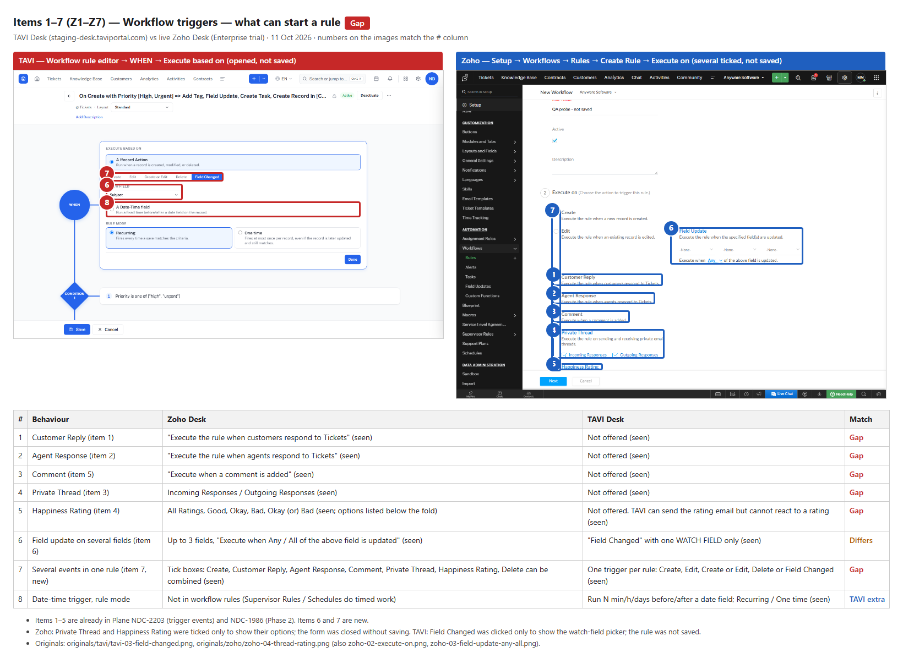
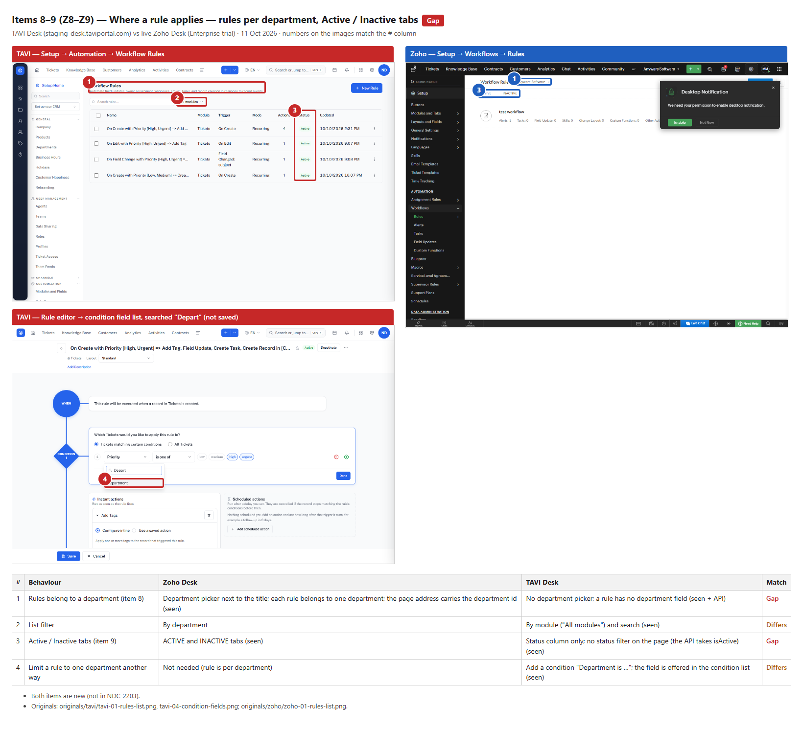
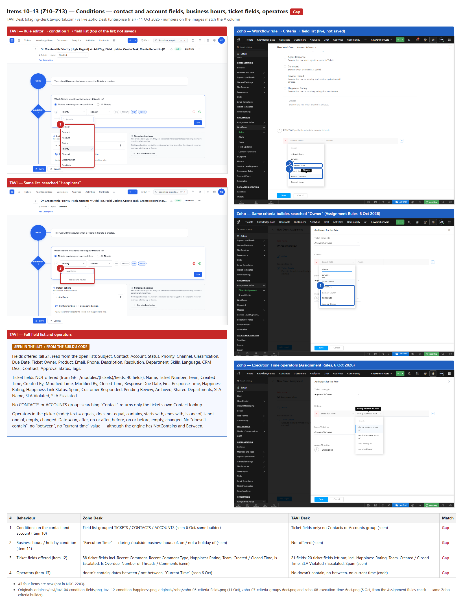
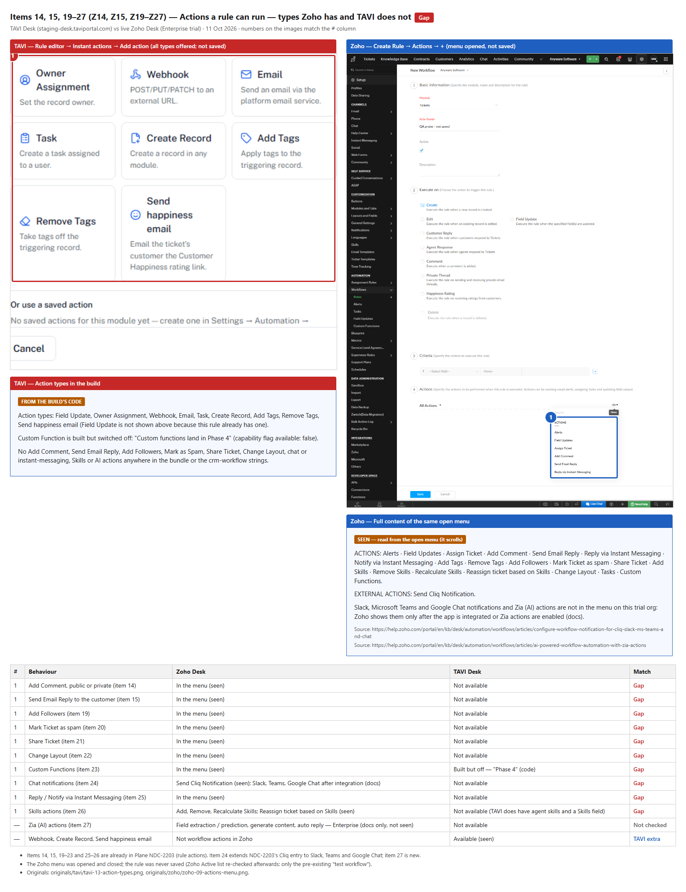
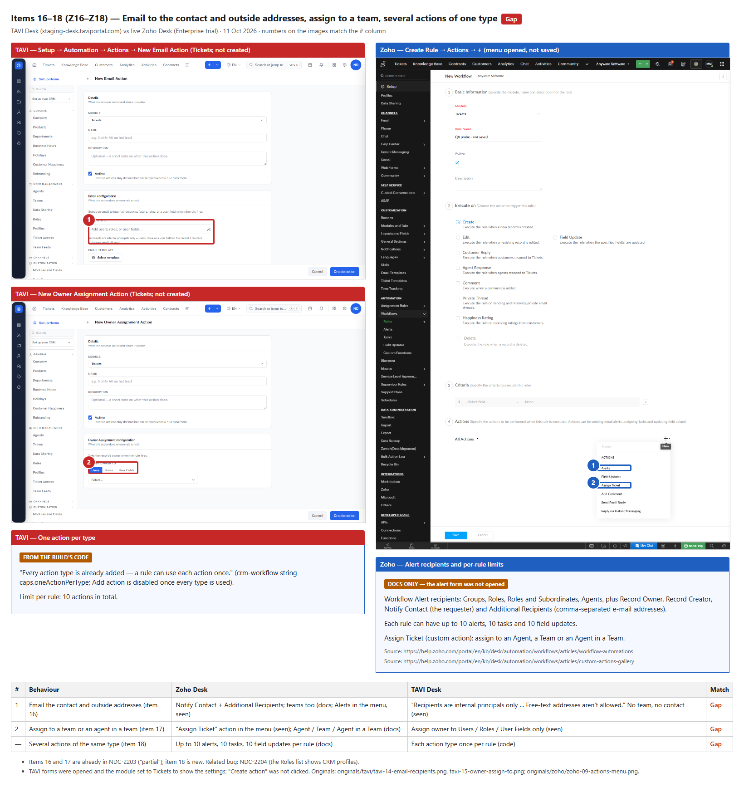
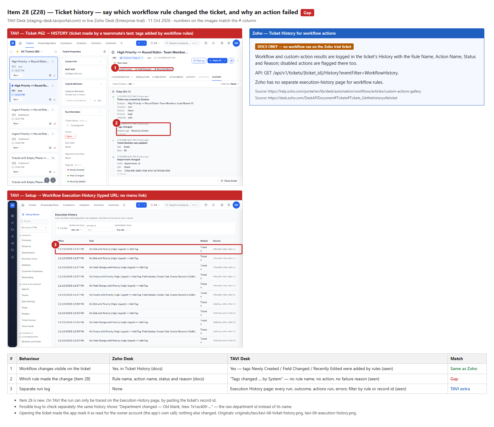

# Evidence — Workflow Rules: TAVI Desk vs Zoho Desk

| | |
|---|---|
| App | TAVI Desk — `https://staging-desk.taviportal.com` (tenant NDC-Staging), owner account |
| Reference | Zoho Desk, live org "anywaresoftwaredesk" (Enterprise trial), admin "CEO", headless Edge |
| Date | 11 Oct 2026 |
| Missing list | [`../desk-workflow-rules-missing-list.md`](../desk-workflow-rules-missing-list.md) (items 1–28) |
| Test spec | [`../spec-desk-workflow-rules.md`](../spec-desk-workflow-rules.md) (Group Z rows Z1–Z28) |
| Status | Draft for review. Nothing filed in Plane |

How to read each image:
- **TAVI** is on the left (red), and **Zoho Desk** is on the right (blue).
- The numbered boxes on the screenshots match the **#** column of the table under them.
- **Match** is one of:
  - **Gap:** Zoho has it, TAVI does not.
  - **Differs**
  - **Same as Zoho**
  - **TAVI extra**
  - **Not checked**
- A text panel instead of a screenshot has a label saying where it comes from:
  - **SEEN — read from the open menu:** the menu scrolls, so the full list is written out.
  - **DOCS ONLY:** Zoho help pages.
  - **FROM THE BUILD'S CODE:** TAVI bundle or strings.
- One image per group of items, as asked: triggers, where a rule applies, conditions, action types, action settings, ticket history.

All captures were read-only:
- **TAVI:** forms were opened and closed without Save or "Create action". The only side effect is that opening ticket #62 marked it as read for the owner account (the app's own call).
- **Zoho:** a New Workflow form was filled with the name "QA probe - not saved", stepped through, and closed. Afterwards the Active list still held only the existing "test workflow".
- **6 Oct images:** two Zoho images (`zoho-07`, `zoho-08`) are from the 6 Oct Assignment Rules check. That check used the same Zoho condition builder. Each caption says so.

The unannotated screenshots are in [`originals/`](originals/). The image settings are in [`configs/`](configs/). To rebuild an image, run `node make-evidence.js configs/<file>.json`.

---

## 01 — Triggers (items 1–7)

- Zoho can run a rule on Customer Reply, Agent Response, Comment, Private Thread (incoming or outgoing) and Happiness Rating. TAVI has none of these.
- Zoho can watch up to 3 fields with Any / All. TAVI watches one field.
- Zoho can tick several events in one rule. TAVI allows one trigger per rule.
- TAVI's Date-Time trigger and One-time mode are extras.

## 02 — Where a rule applies (items 8–9)

- Zoho rules belong to a department and the list has Active / Inactive tabs.
- TAVI rules have no department; only a "Department is …" condition can narrow them.
- TAVI's list has no status filter.

## 03 — Conditions (items 10–13)

- TAVI has no Contacts or Accounts fields and no business-hours / holiday condition.
- 20 of 40 ticket fields are left out of the TAVI condition list, including Happiness Rating, Team, Created Time and the SLA flags.
- The picker has no "doesn't contain", "between" or "current time".

## 04 — Action types (items 14, 15, 19–27)

- Zoho's actions menu has 20 entries. 10 of them have no TAVI equivalent:
  - Add Comment, Send Email Reply, Add Followers, Spam, Share, Change Layout
  - Custom Functions, Cliq, Instant Messaging, Skills
- AI actions are docs only.
- TAVI's Webhook, Create Record and Send happiness email are extras.

## 05 — Action settings (items 16–18)

- The TAVI Email action takes internal recipients only (no contact, no outside addresses, no teams).
- Owner Assignment cannot pick a team.
- A rule can hold each action type only once. Zoho allows up to 10 alerts, 10 tasks and 10 field updates.

## 06 — Ticket history (item 28)

- TAVI's Ticket History shows workflow changes "by System", without the rule or action name.
- Zoho shows the rule, action, status and reason (docs).
- TAVI's Execution History page is an extra, but it has no menu link.
